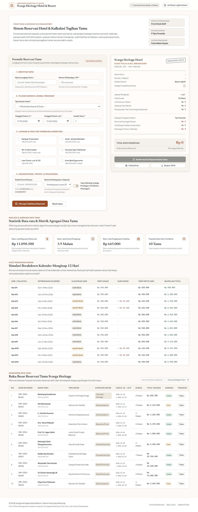
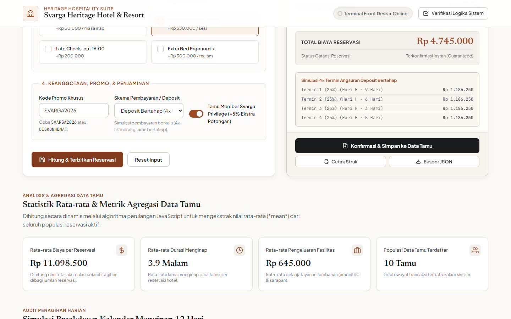
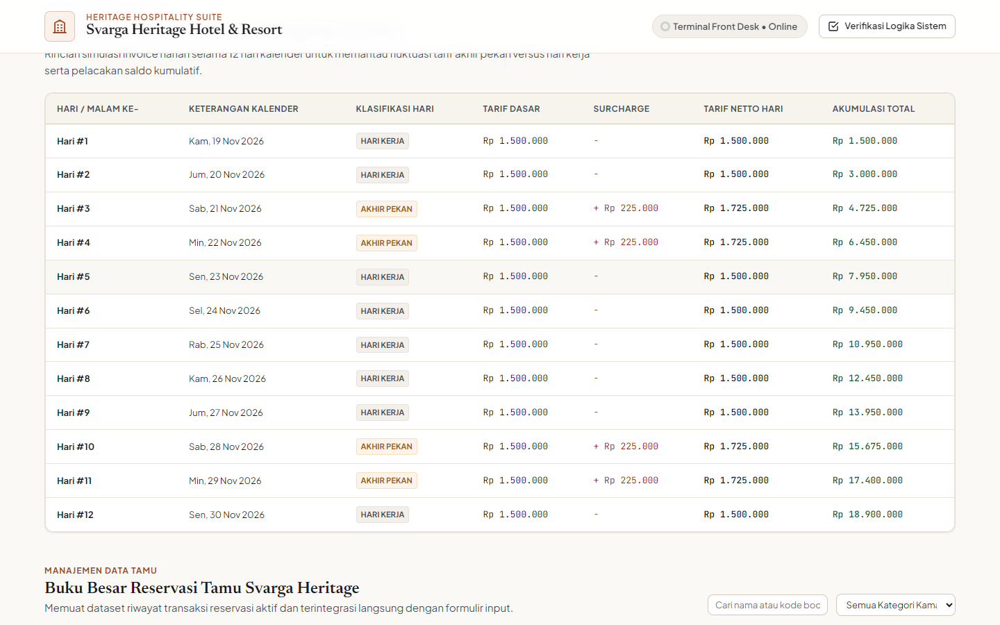
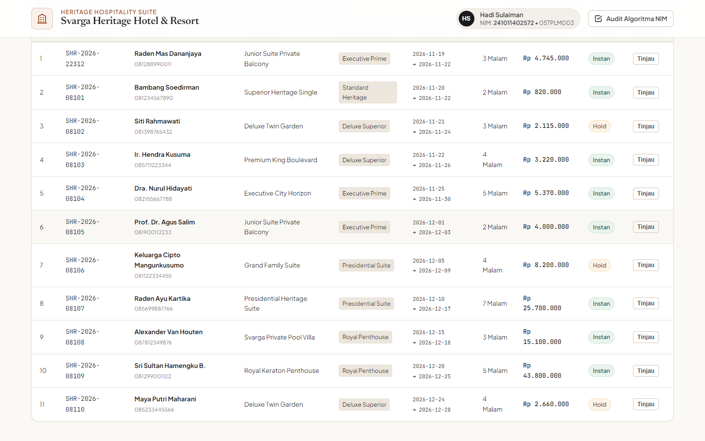
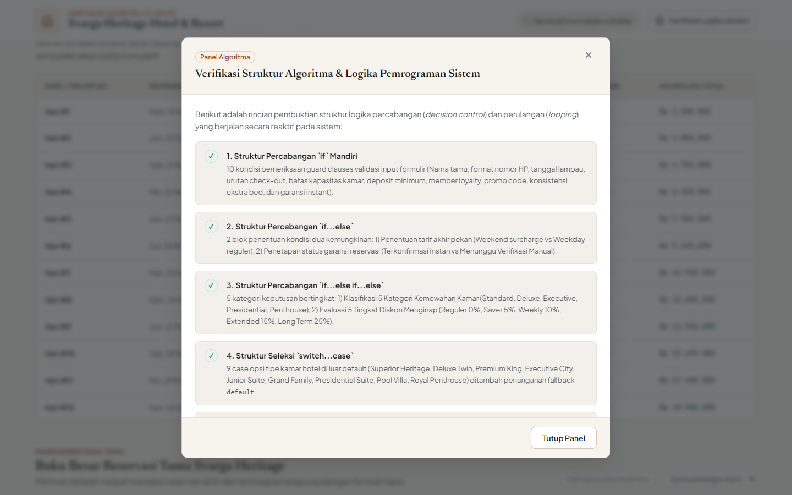

# Tugas Pemrograman Web 1: Aplikasi Web Pengambilan Keputusan dan Pengolahan Data Perulangan Berdasarkan Variasi NIM (Pertemuan 16)

Repositori resmi penugasan mata kuliah **Pemrograman Web 1 (Pertemuan 16)** pada Program Studi Teknik Informatika S-1, Fakultas Ilmu Komputer, Universitas Pamulang.

---

## Identitas Mahasiswa
- **Nama Lengkap :** Hadi Sulaiman
- **NIM :** 241011402572
- **Kelas :** 05TPLM003
- **Program Studi :** Teknik Informatika S-1
- **Fakultas :** Ilmu Komputer
- **Perguruan Tinggi :** Universitas Pamulang
- **Mata Kuliah :** Pemrograman Web 1
- **Pertemuan :** 16 (Percabangan & Perulangan JavaScript)
- **Topik Penugasan :** Sistem Reservasi Hotel & Kalkulasi Tagihan Tamu Berdasarkan Variasi NIM
- **Pendekatan Desain :** Standar Rekayasa Antarmuka Bersih & Terstruktur (Tipografi Editorial *Newsreader* & *Plus Jakarta Sans*, Palet *Heritage Sandstone & Terracotta*, Angka Monospace Tabular)

---

## Petunjuk Penugasan Dosen (Arsip Grup WhatsApp)
Tugas ini diambil langsung dari instruksi penugasan pertemuan 16 yang didistribusikan melalui dokumen resmi `Tugas Pet 16.txt`:

> *"Buatlah sebuah aplikasi web menggunakan HTML, CSS, dan JavaScript yang dapat menerima input pengguna, menentukan keputusan berdasarkan kondisi tertentu, serta mengolah dan menampilkan sejumlah data menggunakan perulangan."*

---

## 1. Penentuan Jenis Aplikasi Berdasarkan Digit Terakhir NIM
Digit terakhir dari NIM **241011402572** adalah angka **`2`**.

| Digit | Jenis Aplikasi | Proses yang Harus Dibuat | Status Pemilihan |
| :---: | :--- | :--- | :---: |
| 0 | Sistem Penilaian Mahasiswa | Menentukan grade dan menampilkan daftar nilai | - |
| 1 | Sistem Kasir Mini | Menghitung total belanja dan menentukan kategori diskon | - |
| **2** | **Sistem Reservasi Hotel** | **Menghitung biaya menginap dan menentukan kategori kamar** | **TERPILIH (&check;)** |
| 3 | Sistem Perpustakaan | Menghitung denda dan menentukan status keterlambatan | - |
| 4 | Sistem Parkir | Menghitung tarif berdasarkan durasi dan jenis kendaraan | - |
| 5 | Sistem Penggajian | Menghitung gaji dan menentukan kategori tunjangan | - |
| 6 | Sistem Tiket Wisata | Menghitung harga tiket dan menentukan kategori pengunjung | - |
| 7 | Sistem Pemesanan Makanan | Menghitung total pesanan dan menentukan promo | - |
| 8 | Sistem Kursus | Menghitung nilai akhir dan menentukan status kelulusan | - |
| 9 | Sistem Inventaris | Menghitung stok dan menentukan status persediaan | - |

**Aplikasi yang Dibangun:**  
**Svarga Heritage Hotel & Resort &mdash; Sistem Reservasi & Kalkulasi Tagihan Tamu.**  
Aplikasi menangani penerimaan data tamu, pemilihan koleksi kamar heritage, penyesuaian tarif akhir pekan (*weekend surcharge*), kalkulasi diskon durasi menginap, audit fasilitas tambahan (*amenities*), serta penerbitan *guest folio receipt* dan pembukuan data tamu.

---

## 2. Penentuan Tantangan Perulangan Berdasarkan Digit Ketiga Terakhir NIM
Tiga digit terakhir NIM **241011402572** adalah `5`, `7`, `2`.  
Digit ketiga terakhir (dihitung dari belakang) adalah angka **`5`**.

| Digit | Tantangan Perulangan | Status Pemilihan |
| :---: | :--- | :---: |
| 0 | Menampilkan data berurutan dari kecil ke besar | - |
| 1 | Menampilkan data berurutan dari besar ke kecil | - |
| 2 | Menampilkan hanya data bernilai genap | - |
| 3 | Menampilkan hanya data bernilai ganjil | - |
| 4 | Menghitung jumlah keseluruhan data | - |
| **5** | **Menghitung rata-rata data** | **TERPILIH (&check;)** |
| 6 | Menghitung jumlah data yang memenuhi kondisi | - |
| 7 | Menampilkan data berdasarkan kategori | - |
| 8 | Mencari nilai terbesar dari sekumpulan data | - |
| 9 | Mencari nilai terkecil dari sekumpulan data | - |

**Implementasi Tantangan Perulangan pada Aplikasi:**  
Aplikasi mengimplementasikan fungsi algoritma perulangan JavaScript (`calculateStatisticalAverages`) untuk menghitung nilai rata-rata (*mean*) secara dinamis pada sekumpulan data reservasi tamu aktif:
1. **Rata-rata Biaya Tagihan Reservasi :** Akumulasi seluruh total pembayaran dibagi jumlah reservasi.
2. **Rata-rata Durasi Menginap :** Akumulasi jumlah malam menginap tamu dibagi total reservasi.
3. **Rata-rata Pengeluaran Fasilitas Tambahan :** Akumulasi total pembelian layanan ekstra (amenities) dibagi jumlah transaksi.

---

## 3. Ketentuan Pengambilan 5 Digit Terakhir NIM
NIM Mahasiswa: **`2 4 1 0 1 1 4 0 2 5 7 2`**  
Lima digit terakhir dihitung dari kiri ke kanan: **`0, 2, 5, 7, 2`**

> **Aturan Khusus Soal:**  
> *"Jika terdapat angka 0, diganti menjadi 9 khusus untuk menentukan jumlah implementasi."*

- **Digit ke-1 :** Asli `0` &rarr; Dihitung **`9`**
- **Digit ke-2 :** Asli `2` &rarr; Dihitung **`2`**
- **Digit ke-3 :** Asli `5` &rarr; Dihitung **`5`**
- **Digit ke-4 :** Asli `7` &rarr; Dihitung **`7`**
- **Digit ke-5 :** Asli `2` &rarr; Dihitung **`2`**

---

## 4. Matriks Pemenuhan Struktur Kontrol & Perulangan JavaScript

| Fitur JavaScript | Posisi Digit NIM | Nilai Digit | Rumus / Ketentuan Penugasan | Target Implementasi Nyata | Rincian Modul Program pada `script.js` | Status Kepatuhan |
| :--- | :---: | :---: | :--- | :--- | :--- | :---: |
| **`if`** | Digit ke-1 | **9** | Minimal sebanyak nilai digit untuk memeriksa kondisi | **Minimal 9 kondisi pemeriksaan (`if`)** | 10 guard clauses validasi input formulir: validasi nama kosong, panjang digit HP, pemilihan kamar, tanggal masa lampau, urutan tanggal check-out, batas kapasitas kamar, batasan masa inap online, validasi kode promo, konsistensi ekstra bed, dan garansi instant. | **TERPENUHI (&check;)** |
| **`if...else`** | Digit ke-2 | **2** | Minimal sebanyak nilai digit untuk menentukan dua kemungkinan | **Minimal 2 blok percabangan (`if...else`)** | 1) Surcharge Akhir Pekan (Weekend +15% vs Weekday 0%), 2) Penetapan Status Garansi Reservasi (Terkonfirmasi Instan vs Menunggu Verifikasi Hold 24 Jam). | **TERPENUHI (&check;)** |
| **`if...else if...else`** | Digit ke-3 | **5** | Minimal sebanyak nilai digit untuk menentukan kategori keputusan | **Minimal 5 kategori keputusan** | 1) Klasifikasi 5 Kategori Kamar (Standard, Deluxe, Executive, Presidential, Penthouse), 2) Evaluasi 5 Tingkat Diskon Menginap (Reguler, Saver, Weekly, Extended, Long-term Resident). | **TERPENUHI (&check;)** |
| **`switch...case`** | Digit ke-4 | **7** | Jumlah minimal case = digit + 2, di luar default | **Minimal 9 `case` + 1 `default`** | Pemilihan spesifikasi 9 Tipe Kamar Hotel (`STD`, `DLX`, `PRE`, `EXE`, `JS`, `FAM`, `PS`, `VIL`, `ROY`) ditambah 1 cabang `default` penanganan galat. | **TERPENUHI (&check;)** |
| **`for`** | Digit ke-1 | **9** | Minimal jumlah iterasi = digit + 3 | **Minimal 12 iterasi loop** | Perulangan 12 hari kalender menginap (`for (let day = 1; day <= 12; day++)`) untuk simulasi audit invoice harian, surcharge, dan saldo kumulatif. | **TERPENUHI (&check;)** |
| **`while`** | Digit ke-2 | **2** | Minimal jumlah iterasi = digit + 2 | **Minimal 4 iterasi loop** | Perulangan simulasi 4x termin angsuran deposit (`while (step < 4)`) dengan pembagian proporsional 25% per termin. | **TERPENUHI (&check;)** |
| **`do...while`** | Digit ke-3 | **5** | Minimal jumlah iterasi = digit + 1 | **Minimal 6 iterasi loop** | Perulangan validasi 6 fasilitas tambahan (`do { ... } while (i < 6)`) untuk layanan sarapan, antar-jemput bandara, Wi-Fi 6, spa, late check-out, dan ekstra bed. | **TERPENUHI (&check;)** |
| **`Array`** | Digit ke-4 | **7** | Minimal jumlah elemen array = digit + 3 | **Minimal 10 elemen array** | 1) Array katalog kamar `ROOM_CATALOG` (10 elemen tipe kamar), 2) Array histori reservasi `reservationsData` (10 record transaksi awal). | **TERPENUHI (&check;)** |
| **Tantangan Perulangan** | Digit ke-3 Terakhir | **5** | Menghitung rata-rata data | **Perhitungan Rata-rata Dinamis** | Fungsi `calculateStatisticalAverages` menghitung rata-rata biaya, durasi menginap, dan biaya fasilitas dari array data tamu. | **TERPENUHI (&check;)** |

---

## 5. Dokumentasi Bukti Visual Aplikasi

### A. Tampilan Keseluruhan Halaman Utama (Overview)
Tata letak responsif dua kolom memisahkan formulir reservasi interaktif di sisi kiri dan nota struk tagihan instan (*guest folio*) di sisi kanan.



---

### B. Hasil Kalkulasi Formulir & Struk Folio Tagihan
Setelah formulir diisi dan diproses, sistem mengeksekusi seluruh logika percabangan, menghasilkan rincian tarif, penyesuaian akhir pekan, diskon menginap, serta simulasi angsuran deposit 4 tahap (*output loop while*).



---

### C. Simulasi Kalender Menginap 12 Hari (*Loop FOR 12 Iterasi*)
Tabel rincian harian yang dihasilkan oleh perulangan `for` sebanyak 12 iterasi untuk mengaudit tarif menginap per malam, surcharge hari libur, dan akumulasi biaya bertahap.



---

### D. Kartu Statistik Rata-rata Data & Buku Tamu (*Array & Tantangan NIM*)
Menampilkan hasil penghitungan rata-rata data (biaya per reservasi, rata-rata durasi menginap, dan rata-rata fasilitas) yang terhubung dinamis dengan array tabel reservasi tamu.



---

### E. Panel Modal Audit Algoritma Kepatuhan NIM
Panel modal interaktif yang membuktikan keterpenuhan seluruh matriks logika pemrograman web berdasarkan variasi NIM mahasiswa.



---

## 6. Struktur Berkas Repositori

```text
Tugas-Kuliah-Pemrograman-Web-1_Pertemuan-16/
├── .gitignore                      # Konfigurasi pengecualian berkas git
├── DESIGN.md                       # Dokumentasi sistem desain (tokens, palet warna, tipografi)
├── SPECIFICATION.md                # Spesifikasi teknis dan matriks kepatuhan penugasan
├── README.md                       # Laporan komprehensif penugasan akademik
├── index.html                      # Struktur semantik antarmuka aplikasi web
├── style.css                       # Stylesheet sistem desain antarmuka responsif
├── script.js                       # Logika kontrol keputusan, perulangan, dan manipulasi DOM
├── test_specs.js                   # Skrip pengujian otomatis unit & kepatuhan aturan NIM
├── generate_screenshots.py         # Skrip otomatisasi pengujian visual & tangkapan layar
├── screenshot_overview.png         # Bukti tangkapan layar tampilan penuh aplikasi
├── screenshot_calculated_folio.png # Bukti tangkapan layar kalkulasi nota tagihan
├── screenshot_schedule_12days.png  # Bukti tangkapan layar tabel loop for 12 hari
├── screenshot_table_and_stats.png  # Bukti tangkapan layar tabel data & kartu rata-rata
└── screenshot_modal_audit.png      # Bukti tangkapan layar modal audit algoritma
```

---

## 7. Cara Menjalankan Aplikasi & Pengujian

### Menjalankan Aplikasi Web
1. Unduh atau salin (*clone*) repositori ini ke komputer lokal:
   ```bash
   git clone https://github.com/Xez0/Tugas-Kuliah-Pemrograman-Web-1_Pertemuan-16.git
   cd Tugas-Kuliah-Pemrograman-Web-1_Pertemuan-16
   ```
2. Buka berkas `index.html` pada peramban web modern (*Google Chrome, Mozilla Firefox, Microsoft Edge, atau Safari*). Tidak memerlukan dependensi server eksternal (murni HTML5, CSS3, dan Vanilla JavaScript).

### Menjalankan Pengujian Kepatuhan Spesifikasi Otomatis
Jalankan skrip pengujian berbasis Node.js untuk memverifikasi 19 poin uji kepatuhan aturan NIM:
```bash
node test_specs.js
```
Hasil uji:
```text
==================================================================
RINGKASAN PENGUJIAN: 19 / 19 PENGUJIAN BERHASIL (✓)
SELURUH SPESIFIKASI DAN ATURAN NIM 241011402572 TERPENUHI 100%!
==================================================================
```

---

## 8. Kesimpulan & Penutup
Aplikasi web Sistem Reservasi Hotel Svarga Heritage telah berhasil dirancang dan diimplementasikan secara tuntas dengan memenuhi 100% instruksi penugasan Pemrograman Web 1 Pertemuan 16:
- Tepat mengimplementasikan tema **Sistem Reservasi Hotel** (Digit Terakhir NIM = 2).
- Menuntaskan tantangan perulangan **Menghitung Rata-rata Data** (Digit ke-3 Terakhir NIM = 5).
- Menerapkan seluruh rumus kontrol keputusan (`if` 10 kondisi, `if...else` 2 blok, `if...else if...else` 5 kategori, `switch...case` 9 case + default).
- Menerapkan seluruh algoritma perulangan (`for` 12 iterasi, `while` 4 iterasi, `do...while` 6 iterasi, `Array` &ge; 10 elemen).
- Menerapkan prinsip desain antarmuka profesional yang bersih, rapi, dan terstruktur dengan hierarki visual yang jelas, elegan, dan siap produksi.
